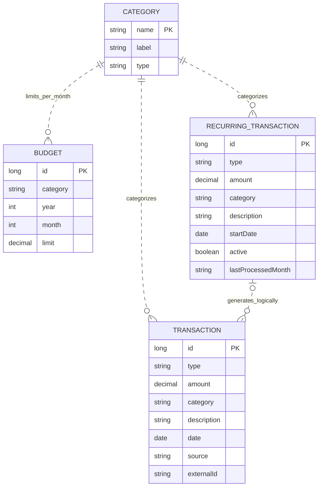

# Er Diagram

These are logical relationships, not SQL foreign keys. CATEGORY is a Java enum, not a stored table. Category/month uniquely identifies a budget; source/externalId uniquely identifies a nonempty imported/generated occurrence. Generated transactions encode rule ID and month in externalId; manual and bank entries have no recurring parent. The CSV layer validates IDs and keys but provides no database referential constraints.

[Standalone Mermaid source](er-diagram.mmd)
