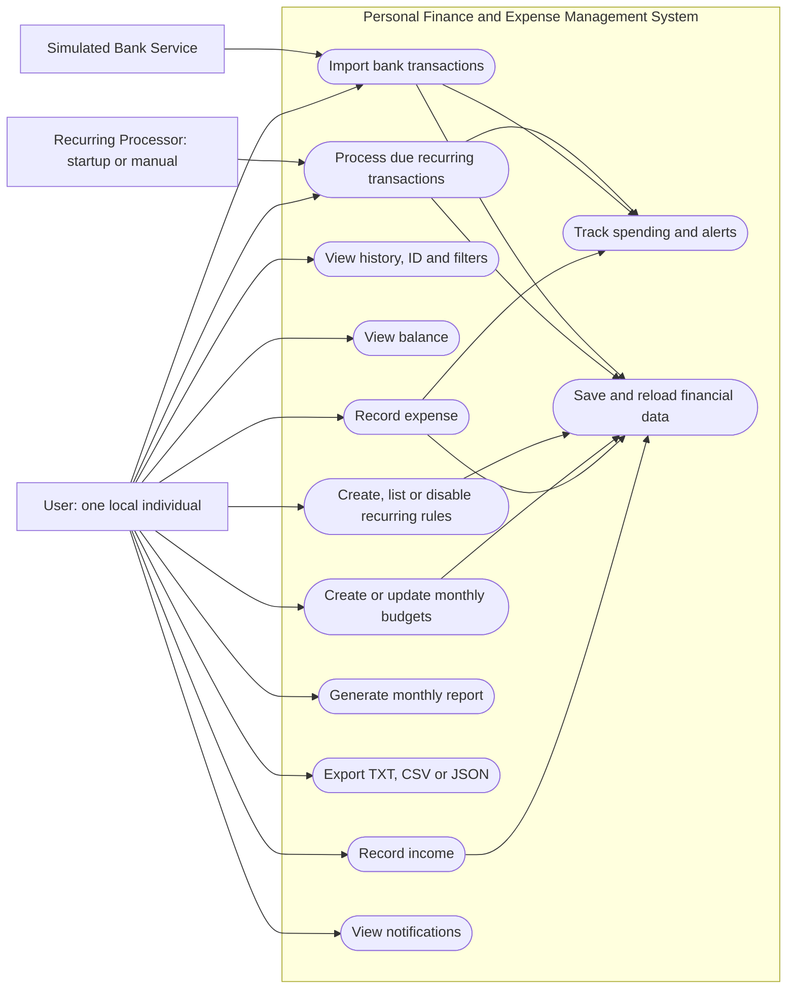

# Use Case Diagram

Mermaid flowchart equivalent of a use-case diagram: rectangles name actors, rounded nodes name use cases. The recurring processor is a local process, not an external scheduled service. Detailed preconditions, alternatives and postconditions appear in REQUIREMENTS.md.

[Standalone Mermaid source](use-case-diagram.mmd)
